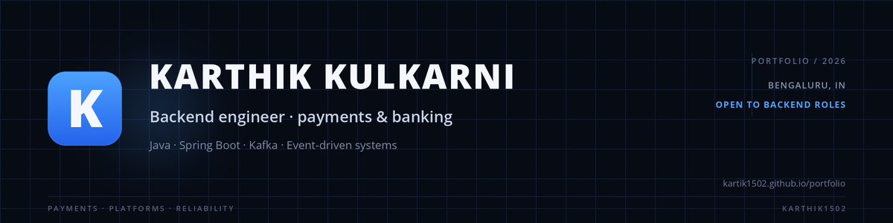

  

  
  
  

**Backend engineer building payment and banking systems.** I work on correctness under failure:
idempotency, reconciliation, and event-driven design.

**Currently:** APAC Payment Acceptance at Citi (via HCLTech) · Bengaluru

---

## Featured work

### [Arya Banking](https://github.com/Event-Based-Banking-Application) — event-driven banking platform

**18 public repositories · 6 Spring Boot services · 104 docs pages**

Kafka, transactional outbox, Avro schemas, Keycloak, Vault, MongoDB. A shared library, a BOM, and a live architecture site.

[Documentation](https://event-based-banking-application.github.io/arya-banking/) · [Source](https://github.com/Event-Based-Banking-Application) · [Architecture](https://event-based-banking-application.github.io/arya-banking/docs/system/system-architecture/)

### [Spring Boot Microservices Banking](https://github.com/kartik1502/Spring-Boot-Microservices-Banking-Application)

**250+ stars · 180+ forks**

5-service banking application with Eureka, Spring Cloud Gateway, Keycloak, and MySQL. A learning project; Arya Banking is the event-driven platform.

---

## Selected contributions

| Project | Merged contributions |
| :--- | :--- |
| **itsaplan** | [Inline checkboxes in issue descriptions](https://github.com/croffasia/itsaplan/pull/656) · [Create a page from a Markdown upload](https://github.com/croffasia/itsaplan/pull/613) · [Clear completed-issue notifications](https://github.com/croffasia/itsaplan/pull/660) |
| **reticle** | [Name enum parameter values in reticle_tools](https://github.com/reticlehq/reticle/pull/1824) |

---

## Focus

| Area | What I work on |
| :--- | :--- |
| **Payments** | Cross-border transaction processing, APAC, reconciliation |
| **Event-driven** | Kafka, transactional outbox, Avro, ordering, idempotent consumers |
| **Platform** | Spring Boot, Spring Cloud, Keycloak, Vault, MongoDB, Docker |

---

## Writing

- [Apache Kafka: Intro and Setup](https://devscribbles.hashnode.dev/apache-kafka-intro-and-setup)
- [Spring Boot Tutorial: Spring Batch](https://devscribbles.hashnode.dev/spring-boot-tutorial-spring-batch)
- [Mastering Microservices: Feign Client](https://devscribbles.hashnode.dev/mastering-microservices-inter-service-communication-using-spring-cloud-feign-client-part-4)

---

  
  
  
  
  
  
  
  

Open to backend roles in Bengaluru or remote.

